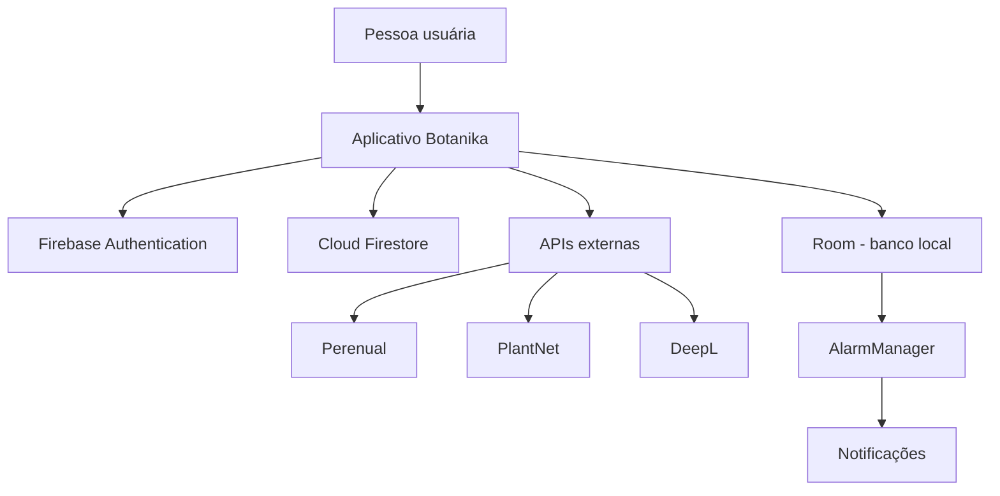

<div align="center">

# 🌿 Botanika

### _Um cantinho para cultivar, descobrir e cuidar._

<p>
  <em>Todo cuidado faz florescer alguma coisa.</em>
</p>


<p>
  <a href="https://github.com/NicoleOG12/Botanika">
    
  </a>
  
  
  
</p>

<p>
  <a href="#-sobre-o-projeto">Sobre</a> ·
  <a href="#-o-que-você-encontra-no-botanika">Funcionalidades</a> ·
  <a href="#-tecnologias-que-dão-vida-ao-projeto">Tecnologias</a> ·
  <a href="#-por-dentro-do-botanika">Estrutura</a> ·
  <a href="#-como-executar">Instalação</a>
</p>

</div>

---

<div align="center">

🌱 &nbsp; ✿ &nbsp; 🍃 &nbsp; ✿ &nbsp; 🌱

</div>

## 🌷 Sobre o projeto

O **Botanika** é um aplicativo Android desenvolvido para tornar o cuidado com plantas mais simples, organizado e acessível.

A proposta é reunir em um só lugar tudo o que ajuda nessa jornada: descobrir novas espécies, conhecer suas características, montar um jardim pessoal, identificar plantas por fotografia e manter uma rotina de cuidados.

Mais do que um catálogo, o Botanika busca ser um companheiro para quem está começando a cultivar ou já tem várias plantinhas em casa. Afinal, cada espécie tem seu próprio jeitinho — e lembrar de todos os cuidados pode ser um desafio. 🌿

O aplicativo foi desenvolvido em **Kotlin**, com interface construída em **Jetpack Compose**, integrando serviços do Firebase, armazenamento local com Room e APIs externas.

---

## 🍃 O que você encontra no Botanika?

<div align="center">

| 🌼 | Recurso | O que faz |
|:---:|---|---|
| 👤 | **Conta e perfil** | Cadastro, login, redefinição de senha e informações do perfil. |
| 🔎 | **Explorar** | Pesquisa de espécies, filtros e consulta de informações botânicas. |
| 🪴 | **Meu Jardim** | Um espaço para adicionar, cadastrar, visualizar e organizar suas plantas. |
| 📸 | **Identificação** | Descoberta de possíveis espécies a partir de uma fotografia. |
| 🗓️ | **Rotina de cuidados** | Lembretes com data, horário e repetição para não esquecer das plantinhas. |

</div>

### 👤 Sua conta, seu espaço

- Criar uma conta com nome, e-mail e senha.
- Entrar e sair da conta.
- Solicitar redefinição de senha por e-mail.
- Manter a opção de lembrar o e-mail no dispositivo.
- Consultar e atualizar o nome do perfil.
- Visualizar informações e estatísticas relacionadas ao jardim.

### 🔎 Um mundo de plantas para explorar

- Consultar o catálogo de espécies disponível no aplicativo.
- Pesquisar pelo nome comum ou científico.
- Utilizar filtros para facilitar a descoberta, incluindo opções relacionadas a ambientes internos e exposição ao sol.
- Acessar os detalhes de cada espécie.
- Consultar informações botânicas e orientações de cuidado disponíveis.

### 🪴 Seu próprio jardim

- Adicionar plantas ao jardim a partir do catálogo.
- Cadastrar uma planta manualmente.
- Incluir imagem no cadastro.
- Visualizar as plantas associadas à conta.
- Acessar os detalhes de cada planta.
- Remover plantas do jardim.

### 📸 Descubra uma planta pela foto

Não sabe o nome daquela plantinha que chamou sua atenção? O Botanika possui um fluxo de identificação por imagem integrado ao PlantNet.

- Fotografar uma planta usando a câmera do dispositivo.
- Escolher uma imagem da galeria.
- Enviar a imagem ao PlantNet para identificação.
- Visualizar possíveis correspondências, nome científico e percentual de confiança.
- Selecionar um resultado para consultar informações ou adicionar a planta ao jardim.

> 🌱 **Atenção:** a identificação depende de uma chave válida do PlantNet, conexão com a internet e disponibilidade/limites da API. A integração está presente no código, mas precisa estar configurada para funcionar em cada instalação.

### 🗓️ Cuidados no tempo certo

- Criar lembretes associados às plantas.
- Definir o tipo de cuidado, data e horário.
- Configurar repetição em dias específicos.
- Consultar os cuidados programados na área de rotina.
- Receber notificações locais no horário definido.
- Manter os lembretes salvos no dispositivo.
- Reagendar alarmes após reinicialização do aparelho ou atualização do aplicativo.

<div align="center">

_Água, luz, carinho e um lembrete de vez em quando. Cada detalhe importa._ 💚

</div>

---

## 🧰 Tecnologias que dão vida ao projeto

As ferramentas utilizadas no desenvolvimento do Botanika estão organizadas por função. Os logos abaixo ajudam a identificar algumas das principais tecnologias do projeto.

<div align="center">

### 📱 Desenvolvimento Android

<a href="https://kotlinlang.org/"></a>
&nbsp;&nbsp;
<a href="https://developer.android.com/"></a>
&nbsp;&nbsp;
<a href="https://gradle.org/"></a>

**Kotlin** · **Android Studio** · **Gradle Kotlin DSL**

<br />

### 🎨 Interface e experiência

<a href="https://developer.android.com/develop/ui/compose"></a>
&nbsp;
<a href="https://m3.material.io/"></a>

<br />

### ☁️ Dados e serviços

<a href="https://firebase.google.com/"></a>
&nbsp;&nbsp;
<a href="https://www.sqlite.org/"></a>

**Firebase Authentication** · **Cloud Firestore** · **Room**

<br />

### 🔌 APIs e integrações

<a href="https://perenual.com/docs/api"></a>
&nbsp;
<a href="https://plantnet.org/"></a>
&nbsp;
<a href="https://www.deepl.com/"></a>

</div>

### Outras bibliotecas e recursos

| Tecnologia | Como aparece no Botanika |
|---|---|
| **Navigation Compose** | Navegação entre as telas do aplicativo. |
| **ViewModel** | Gerenciamento do estado e das ações da aplicação. |
| **Kotlin Coroutines** | Execução de operações assíncronas. |
| **CameraX** | Acesso à câmera e captura de fotografias. |
| **Room** | Persistência local dos lembretes. |
| **Gson** | Conversão de dados JSON em objetos Kotlin. |
| **KSP** | Processamento de anotações utilizado pelo Room. |
| **AlarmManager** | Agendamento dos alarmes dos lembretes. |
| **BroadcastReceiver** | Recebimento dos alarmes e eventos de reinicialização/atualização. |
| **Android Notifications** | Exibição das notificações de cuidado. |

### 🌐 APIs e serviços

**Perenual** — fonte de informações sobre espécies de plantas. O projeto possui integração para consulta de espécies e detalhes botânicos. Os dados do catálogo também são organizados e consultados pela coleção `plantas_perenual` no Firestore.

**PlantNet** — serviço utilizado no fluxo de identificação por imagem. A fotografia é enviada ao serviço e o aplicativo recebe possíveis correspondências, que podem ser relacionadas ao catálogo disponível.

**DeepL** — serviço de tradução de informações botânicas, como nomes e descrições, contribuindo para apresentar os dados em português. O código também mantém um cache em memória para evitar repetir traduções já realizadas.

**Firebase** — utilizado para autenticação de contas e armazenamento remoto de dados no Cloud Firestore.

> A disponibilidade de cada integração depende de credenciais válidas, configuração dos serviços e limites definidos pelos respectivos provedores.

---

## 🌳 Por dentro do Botanika

O projeto foi organizado para separar a interface dos serviços responsáveis pelo acesso aos dados locais e remotos.

```text
Botanika/
├── app/
│   ├── src/main/
│   │   ├── java/com/example/botanika/
│   │   │   ├── data/
│   │   │   │   ├── local/
│   │   │   │   │   ├── AppDatabase.kt
│   │   │   │   │   ├── LembreteDAO.kt
│   │   │   │   │   ├── LembreteEntity.kt
│   │   │   │   │   ├── LembreteReciever.kt
│   │   │   │   │   └── LembreteService.kt
│   │   │   │   └── remote/
│   │   │   │       ├── DeepLApi.kt
│   │   │   │       ├── PerenualApi.kt
│   │   │   │       ├── PerenualService.kt
│   │   │   │       ├── PlantNetService.kt
│   │   │   │       ├── PlantasService.kt
│   │   │   │       ├── PlantaDetalhesDto.kt
│   │   │   │       └── UsuarioService.kt
│   │   │   ├── ui/
│   │   │   │   ├── animation/
│   │   │   │   ├── camera/
│   │   │   │   ├── components/
│   │   │   │   ├── explore/
│   │   │   │   ├── garden/
│   │   │   │   ├── home/
│   │   │   │   ├── login/
│   │   │   │   ├── logo/
│   │   │   │   ├── plants/
│   │   │   │   ├── profile/
│   │   │   │   ├── register/
│   │   │   │   ├── routine/
│   │   │   │   ├── splash/
│   │   │   │   ├── testes/
│   │   │   │   ├── theme/
│   │   │   │   └── welcome/
│   │   │   ├── AppState.kt
│   │   │   ├── BotanikaApp.kt
│   │   │   └── MainActivity.kt
│   │   └── AndroidManifest.xml
│   └── build.gradle.kts
├── gradle/
│   ├── wrapper/
│   └── libs.versions.toml
├── build.gradle.kts
├── gradle.properties
├── settings.gradle.kts
└── gradlew
```

### 🧩 Como cada parte trabalha

| Parte | Responsabilidade |
|---|---|
| `data/local` | Banco Room, entidade, DAO e gerenciamento dos lembretes e alarmes locais. |
| `data/remote` | Comunicação com Firebase e APIs externas, autenticação, catálogo, tradução e identificação. |
| `ui` | Telas, componentes reutilizáveis, elementos visuais, animações e tema. |
| `ui/components` | Componentes compartilhados entre diferentes telas. |
| `ui/theme` | Cores, tipografia e configuração visual do aplicativo. |
| `AppState.kt` | ViewModel que concentra o estado e coordena operações da aplicação. |
| `BotanikaApp.kt` | Composição da aplicação, transições e navegação entre telas. |
| `MainActivity.kt` | Ponto de entrada da aplicação Android. |

### 🪴 Mapa das telas

| Tela | Para que serve |
|---|---|
| Splash | Apresentação inicial do aplicativo. |
| Boas-vindas | Entrada para os fluxos de acesso e cadastro. |
| Login | Autenticação de uma conta existente. |
| Cadastro | Criação de uma nova conta. |
| Início | Visão geral e atalhos para as principais áreas. |
| Explorar | Pesquisa e descoberta de espécies. |
| Meu Jardim | Lista de plantas associadas à conta. |
| Detalhes da planta | Informações e orientações sobre a planta selecionada. |
| Câmera | Captura de foto ou seleção de imagem da galeria. |
| Resultado da identificação | Correspondências retornadas pelo serviço de identificação. |
| Adicionar planta | Escolha do fluxo para incluir uma planta no jardim. |
| Formulário da planta | Cadastro e edição das informações de uma planta. |
| Rotina | Organização dos cuidados e lembretes. |
| Formulário de lembrete | Configuração de data, horário e repetição. |
| Perfil | Informações da conta e estatísticas do jardim. |

### 🔄 Caminho dos dados



O Botanika combina armazenamento remoto e local:

1. O Firebase Authentication realiza o cadastro e o login.
2. Os dados de perfil são consultados e atualizados no Cloud Firestore.
3. O catálogo e os detalhes das espécies são consultados pelos serviços de dados do aplicativo, que utilizam a coleção `plantas_perenual` no Firestore e a integração com a Perenual.
4. As plantas adicionadas ao jardim são associadas ao identificador do usuário autenticado na coleção `plantasXusuario`.
5. Os lembretes são armazenados localmente no Room.
6. O AlarmManager agenda os horários definidos. O BroadcastReceiver recebe os alarmes, apresenta as notificações e auxilia no reagendamento após reinicializações e atualizações.
7. No fluxo de identificação, a imagem é enviada ao PlantNet. Os resultados retornados podem ser associados ao catálogo para exibir informações da espécie.

---

## 🌱 Como executar

Quer cultivar o projeto na sua máquina? Vamos lá!

### Pré-requisitos

- Android Studio.
- JDK 11 ou compatível com a configuração do projeto.
- Android SDK 35.
- Dispositivo ou emulador com Android 7.0 (API 24) ou superior.
- Conexão com a internet.
- Projeto Firebase configurado para Android.

**Configurações atuais do módulo:**

| Configuração | Valor |
|---|---:|
| `minSdk` | 24 |
| `compileSdk` | 35 |
| `targetSdk` | 35 |

### 1. Clone o repositório

```bash
git clone https://github.com/NicoleOG12/Botanika.git
cd Botanika
```

### 2. Abra no Android Studio

Abra a pasta do projeto no Android Studio e aguarde a sincronização do Gradle e o download das dependências.

### 3. Configure o Firebase

1. Acesse o [Firebase Console](https://console.firebase.google.com/).
2. Crie um projeto ou utilize um projeto existente.
3. Registre um aplicativo Android com o identificador `com.example.botanika`.
4. Habilite o **Firebase Authentication** com e-mail e senha.
5. Habilite o **Cloud Firestore**.
6. Baixe o arquivo `google-services.json` e coloque-o dentro da pasta `app/`.

Não publique arquivos de configuração privados nem compartilhe credenciais do seu projeto.

### 4. Configure as APIs

A chave do PlantNet é lida pelo Gradle a partir do arquivo `local.properties`, na raiz do projeto.

Adicione a propriedade abaixo, substituindo pelo valor da sua própria chave:

```properties
PLANTNET_API_KEY=SUA_CHAVE_PLANTNET
```

As integrações com Perenual e DeepL também exigem credenciais. **Na versão atual do código, as chaves desses serviços estão declaradas diretamente nas classes de integração.** Antes de distribuir o aplicativo ou manter o repositório público, migre essas credenciais para uma configuração segura, remova-as do histórico do Git e gere novas chaves. Não coloque chaves reais neste README.

### 5. Execute o aplicativo

Com um dispositivo ou emulador conectado, selecione a configuração `app` no Android Studio e clique em **Run**.

Também é possível gerar a versão de depuração pelo terminal:

```bash
./gradlew assembleDebug
```

No Windows:

```bat
gradlew.bat assembleDebug
```

---

## 🧪 Testes

O repositório contém arquivos de testes relacionados a fluxos importantes do aplicativo, organizados em `ui/testes`, incluindo:

- Navegação entre telas.
- Cadastro.
- Login.
- Detalhes de plantas.
- Lembretes.
- Lista de plantas.
- Meu Jardim.

A existência desses arquivos não representa, por si só, uma garantia de cobertura completa. A execução e os resultados devem ser conferidos no ambiente Android Studio/Gradle.

## 🔐 Permissões e segurança

De acordo com o `AndroidManifest.xml`, o aplicativo declara permissões relacionadas a:

- Acesso à internet, para comunicação com Firebase e APIs.
- Uso da câmera, para captura de fotografias.
- Envio de notificações.
- Agendamento de alarmes.
- Recebimento de eventos de inicialização e atualização do aplicativo.

O funcionamento de câmera, alarmes e notificações pode depender das permissões concedidas e das configurações da versão do Android instalada.

**Cuidados importantes com credenciais:**

- Não versione chaves de API, tokens ou arquivos privados.
- As credenciais de Perenual e DeepL presentes diretamente no código precisam ser substituídas e protegidas.
- A chave do PlantNet deve permanecer em configuração local, fora do controle de versão.
- Configure as regras do Firestore para restringir o acesso aos dados de cada usuário.
- Se uma chave for publicada acidentalmente, revogue-a no serviço correspondente e gere outra. Apenas apagar a chave do código atual não a remove do histórico do Git.

---

## 🌻 Quem está cultivando esse projeto?

<div align="center">

<a href="https://github.com/NicoleOG12">
  
</a>
&nbsp;&nbsp;&nbsp;&nbsp;
<a href="https://github.com/stela-sm">
  
</a>

<br />

**[Nicole](https://github.com/NicoleOG12)** &nbsp; · &nbsp; **[Stela](https://github.com/stela-sm)**

</div>

---

<div align="center">


### 🌿 Botanika

_Que nunca faltem motivos para florescer._

</div>
